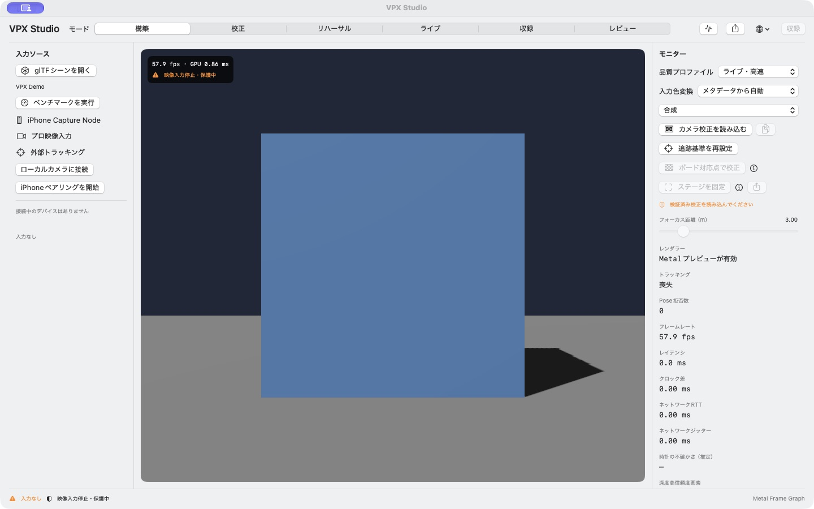

# VPX Studio

Apple Silicon向けのリアルタイム・バーチャルプロダクション基盤です。

## スクリーンショット



日本語UIでのデモシーン表示（実機入力なし）。

## 現在の実装

- MetalKitによる60fpsプレビュー土台
- デバイス／映像／Pose／レンズ／深度の共通データ契約
- 依存関係を検証するRealtime Frame Graph
- iPhone Capture Nodeを接続するためのアダプタ境界
- SwiftUIのスタジオ画面
- 日本語、English、简体中文を実行中に切り替えるローカライズカタログ
- システム設定、ライト、ダークを切り替える表示モード

## 起動

```sh
swift run VPXStudio
```

Xcodeで開発する場合は、`Package.swift`を開きます。

## 表示言語の追加

`Sources/VPXStudio/Resources/LocalizationCatalog.json` の `languages` 配列に、
`id`、表示名、既存キーすべての翻訳を持つ言語オブジェクトを追加します。言語選択メニューはカタログを読み込むため、Swiftコードを変更せずに候補へ追加されます。

## 実装状況と操作

- 🟢 [Done] AVFoundationローカル入力とBGRA／8・10-bit YUVのMetal取込。
- 🟢 [Done] 限定glTFシーン、PBR・影、校正JSON、レンズ補正・breathing、独立マットとSDR合成、LIVE出力保護。
- 🟢 [Done] ボード対応点からの姿勢・残差計算、校正revision生成・保存、レンズ設定の適用範囲チェック。[入力形式と操作](docs/CHECKERBOARD-CALIBRATION.md)を参照。画像からの自動交点検出はNext、実ボードでの精度認定はPending。
- 🟢 [Done] iPhone Capture NodeのAVCapture／ARKit排他取得、深度・confidence転送、認証付きUDP Pose／IMU、品質イベントと時刻の不確かさ管理。[Phase 2仕様・起動手順](docs/PHASE2.md)を参照。
- ⭕️ [Pending] 実iPhoneの署名・権限、LiDAR、Wi-Fi伝送・整列・長時間運用の受入検証。
- 🔴 [Later] SDI/NDI、外部トラッカー、Take収録、LED wall出力。

[Phase 1の操作・対応範囲](docs/PHASE1.md)と[詳細ロードマップ](docs/ROADMAP.md)を参照してください。`Examples/Phase1`にglTFと校正JSONのサンプルを用意しています。校正サンプルは推定値であり、実機測定値ではありません。
